# p3a: Pixel Art Player

**A 4-inch smart art frame powered by ESP32-P4.** Plays animated pixel art from [Makapix Club](https://makapix.club/), trending GIFs from [Giphy](https://giphy.com/) and [Klipy](https://klipy.com/), masterpieces from major museums via [IIIF](https://iiif.io/), and your own files on a 24-bit 720x720 IPS touchscreen you control from anywhere. Build it yourself from a $40 board, in about 15 minutes. After that, it just keeps playing.

<br clear="left"/>

<p align="center">
  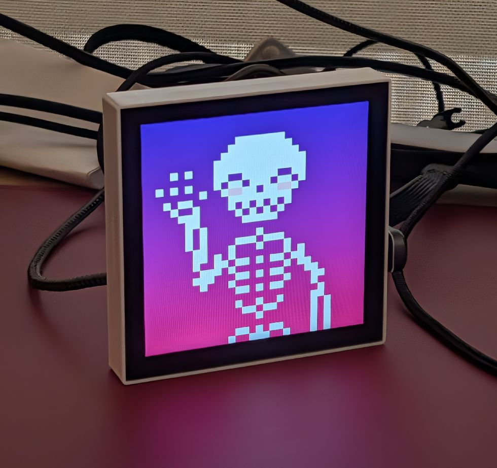
  &nbsp;
  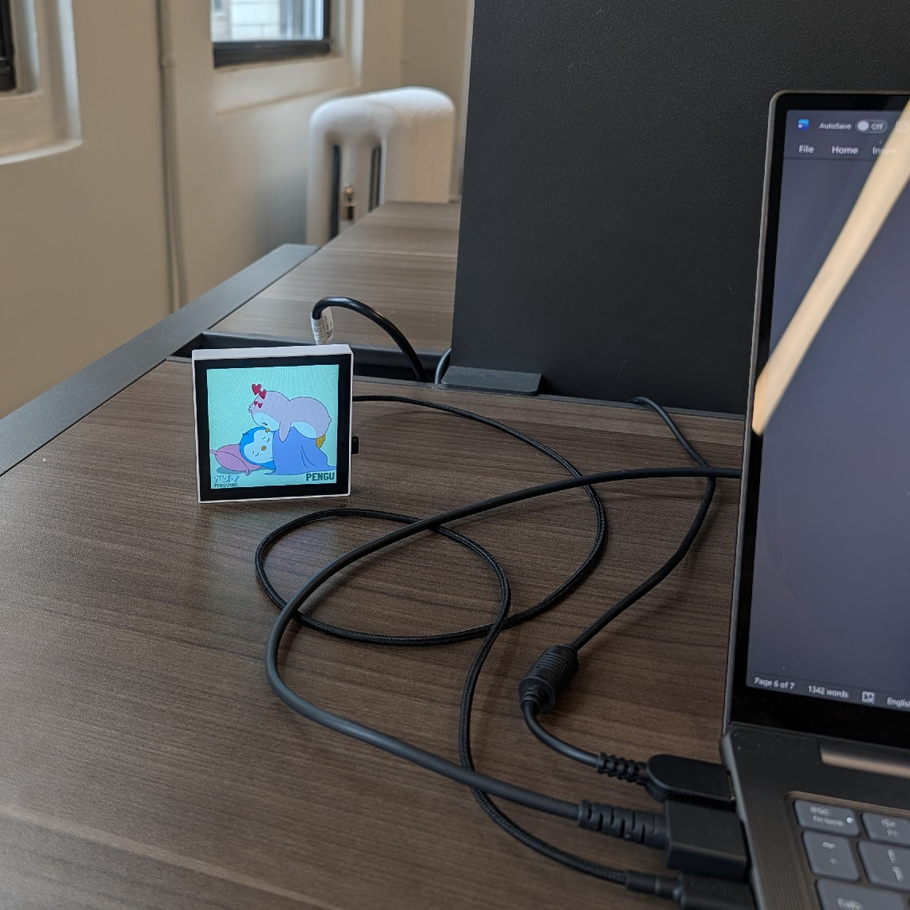
  &nbsp;
  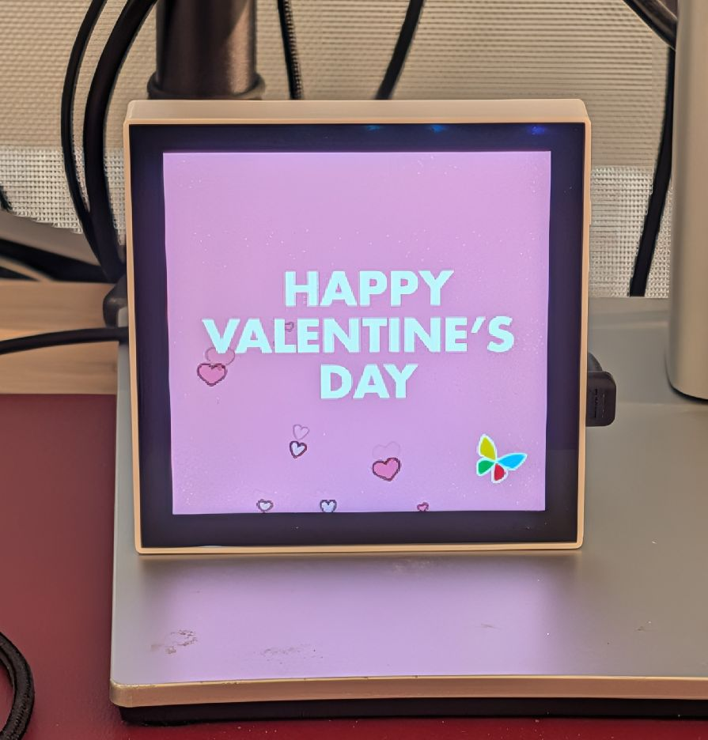
  &nbsp;
  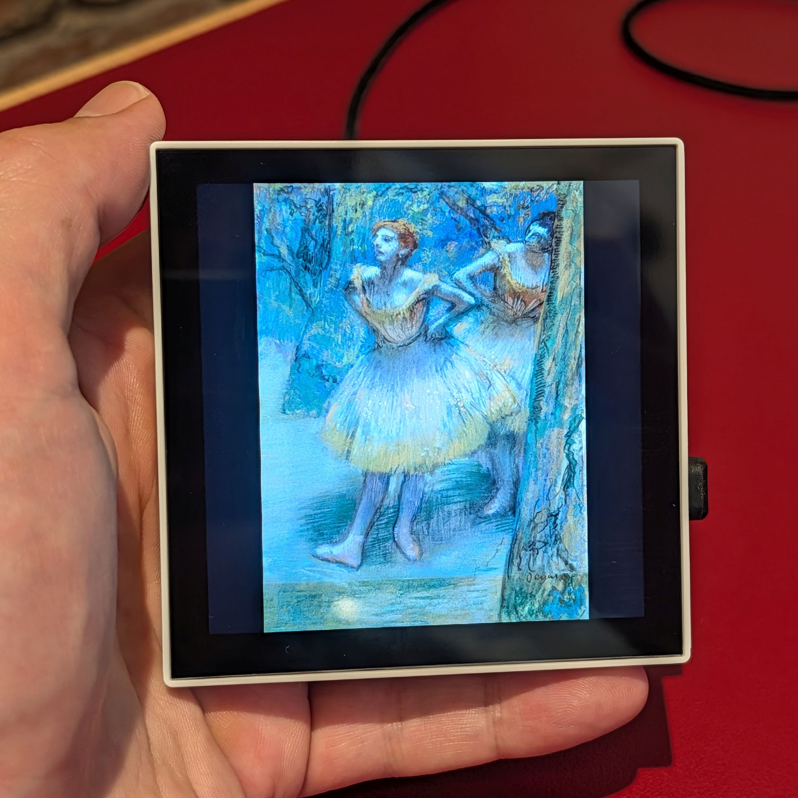
</p>

<p align="center">
  <a href="https://discord.gg/xk9umcujXV"></a>&nbsp;
  <a href="LICENSE"></a>&nbsp;
  <a href="https://github.com/fabkury/p3a/releases"></a>
</p>

<p align="center">
  <a href="https://discord.gg/xk9umcujXV"><strong>Discord</strong></a> · <a href="https://makapix.club/"><strong>Makapix Club</strong></a> · <a href="docs/HOW-TO-USE.md"><strong>User Guide</strong></a> · <a href="https://fabkury.github.io/p3a/web-flasher/"><strong>Web Flasher</strong></a> · <a href="https://makezine.com/projects/desktop-pixel-art-player-p3a/"><strong>Makezine Article</strong></a>
</p>

---

## What Is p3a?

p3a turns a [$40 development board](https://www.waveshare.com/esp32-p4-wifi6-touch-lcd-4b.htm?sku=31416) (also on [Amazon](https://www.amazon.com/dp/B0FF3Z1NNL/)) into a dedicated pixel art display. Think of it as a tiny gallery on your desk: it cycles through artworks automatically, picks up trending GIFs throughout the day, and lets you send artworks directly to it from [Makapix Club](https://makapix.club/), a pixel art social network. It also fetches countless artworks from museum IIIF endpoints.

It's open source, self-contained, and designed to be as simple to use as a picture frame, while still exposing a full REST API for those who want to automate and tinker. Both the hardware and the firmware are built for 24/7 operation, so you can leave it running on a desktop, shelf or wall indefinitely.

<p align="center">
  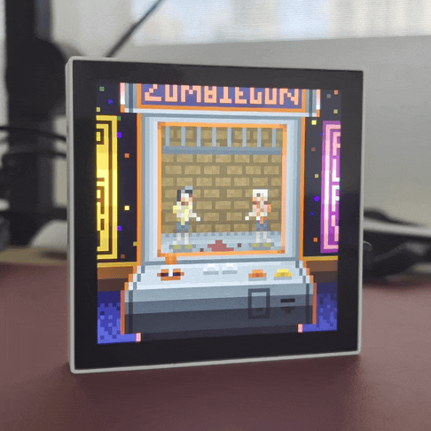
</p>

---

## Quick Start

Every p3a was assembled by the person who owns it. Joining them takes a screwdriver and 15 minutes.

**What you need:**
- [Waveshare ESP32-P4-WIFI6-Touch-LCD-4B](https://www.waveshare.com/esp32-p4-wifi6-touch-lcd-4b.htm?sku=31416) board ($39.99) (also on [Amazon](https://www.amazon.com/dp/B0FF3Z1NNL/))
- Any [microSD card](https://www.waveshare.com/raspberry-pi-sd-card.htm) (4 GB minimum, 16+ GB recommended)
- USB-C data cable
  - Any data cable works, but a slim right-angle cable that bends backwards tucks neatly behind the device: [USB-A to USB-C](https://www.amazon.com/dp/B0DQSJHLDM) · [USB-C to USB-C](https://www.amazon.com/dp/B0DQ89GVNM)
- Any USB power source
  - p3a draws very little power, so any 5V 1A (or more) phone charger or a computer USB port is plenty
- A small screwdriver

**Setup steps:**

1. **Insert the microSD card** (requires unscrewing the back plate)
2. **Flash the firmware** using the [p3a Web Flasher](https://fabkury.github.io/p3a/web-flasher/). Connect, click, done. No software to install. ([Alternative methods](docs/flash-p3a.md))
3. **Connect to Wi-Fi**: on first boot, join the `p3a-setup` network and enter your Wi-Fi on the page that opens
4. **Start playing art**: add a [Giphy](https://developers.giphy.com/) or [Klipy](https://partner.klipy.com/) API key for trending GIFs, register at [makapix.club](https://makapix.club/) to send artworks, or copy your own files via USB

> The initial flash requires a computer with USB. After that, all updates are wireless.
>
> Coming from p3a 1.x? 2.0 is installed once over USB and starts the device fresh. See [Moving a p3a from 1.x to 2.0](docs/migrating-to-2.0.md).

For a step-by-step walkthrough written for first-time owners, see the [Quick Start Guide](docs/QUICK-START.md). For full usage instructions, see [HOW-TO-USE.md](docs/HOW-TO-USE.md). Stuck on any step? The [Discord server](https://discord.gg/xk9umcujXV) is friendly, ask there.

---

## Features

### Five Sources of Content

| Source | What it does |
|--------|-------------|
| **[Makapix Club](https://makapix.club/)** | Browse a pixel art social network and send artworks directly to your p3a. Play entire channels like "Promoted Artworks" and "All Artworks", or hashtags like "#nintendo". Control your device remotely from anywhere. |
| **[Giphy](https://giphy.com/)** | Automatically fetches and cycles through trending GIFs and GIF searches. Configurable content rating (G through R) and refresh interval. |
| **[Klipy](https://klipy.com/)** | Automatically fetches and cycles through trending, search, and category channels of GIFs and stickers. Configurable content rating, format (GIF/WebP), and refresh interval. |
| **Museums** | Browse public collections from the Rijksmuseum, Victoria and Albert Museum, Wellcome Collection, the Statens Museum for Kunst (SMK), Harvard Art Museums, the Smithsonian, the Cleveland Museum of Art, and the Minneapolis Institute of Art. Pick a department, category, or curated set; the device refreshes the listing on schedule. |
| **Local files** | Copy your own WebP, GIF, PNG/APNG, JPEG, or BMP files via USB or Wi-Fi. No cloud account needed, no internet required. |

Mix them all in a single "playset" for an ever-changing display.

<p align="center">
  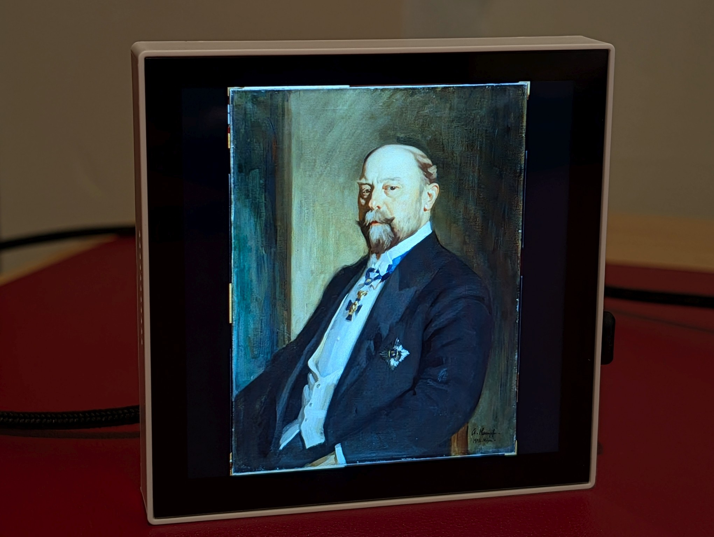
  &nbsp;
  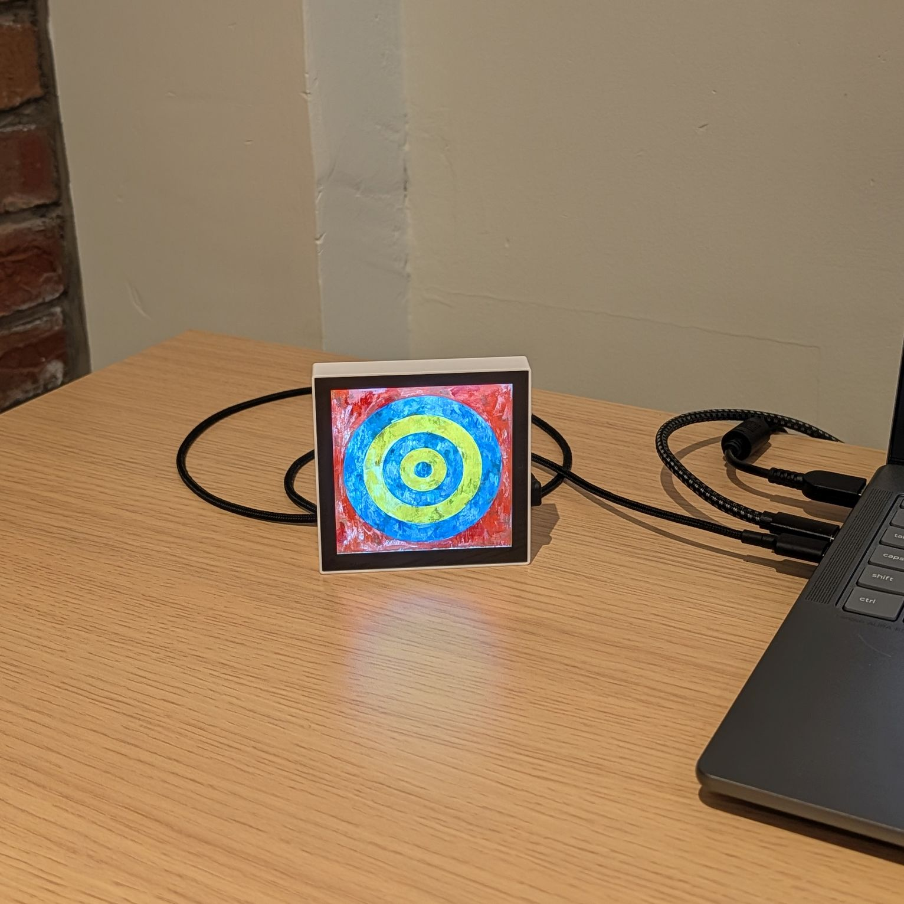
  &nbsp;
  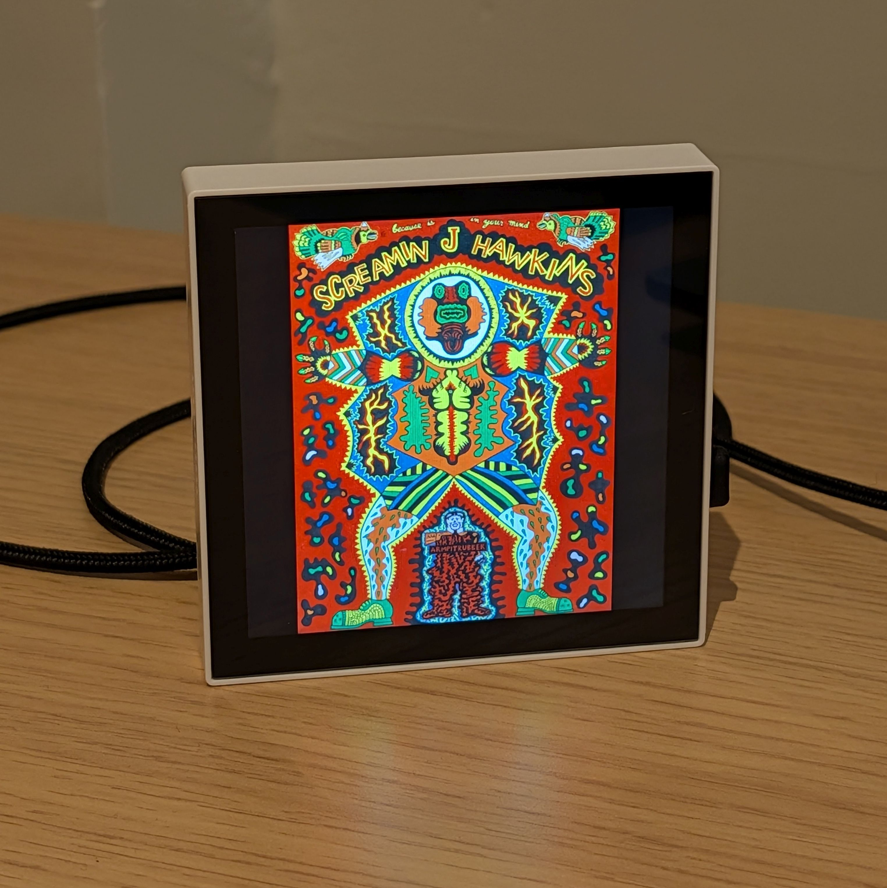
  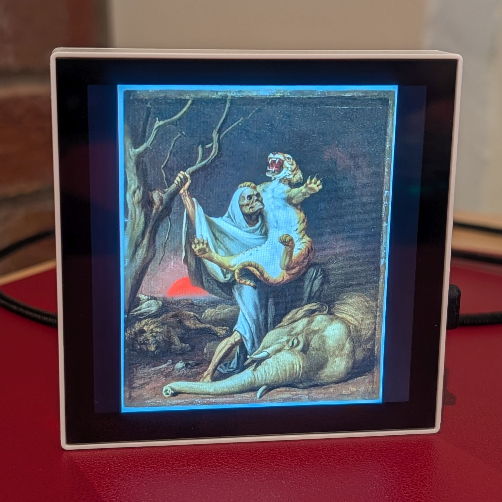
</p>

<p align="center"><em>Museum channels: works from the Rijksmuseum, V&amp;A, Wellcome Collection, SMK, Harvard Art Museums, the Smithsonian, the Cleveland Museum of Art, and the Minneapolis Institute of Art.</em></p>

<p align="center">
  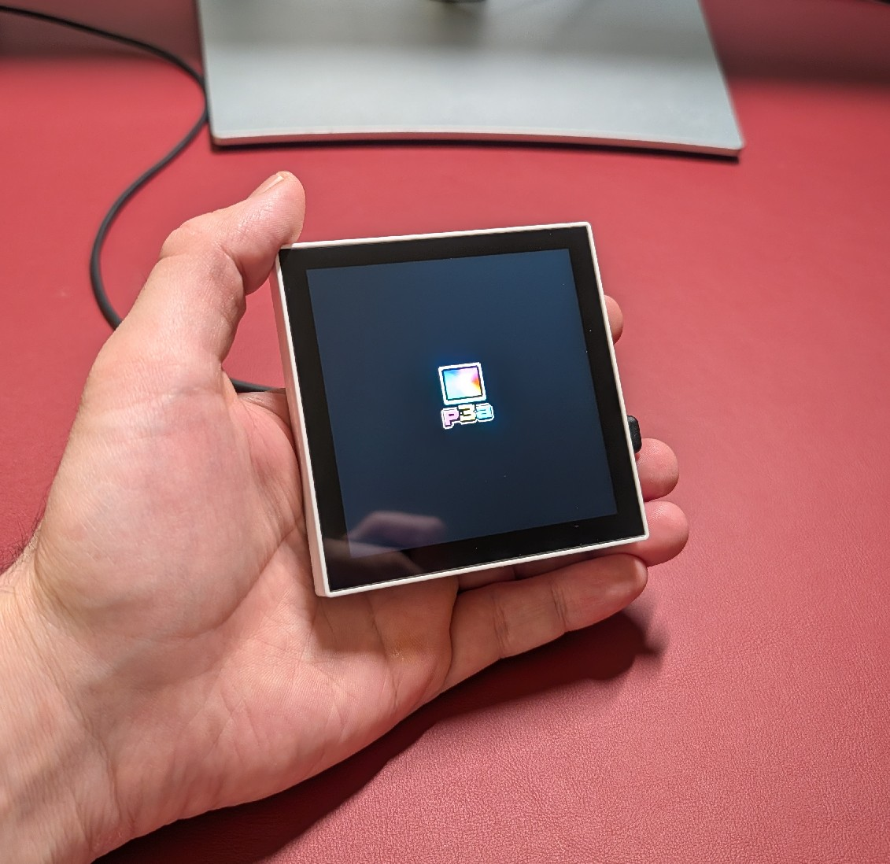
  &nbsp;
  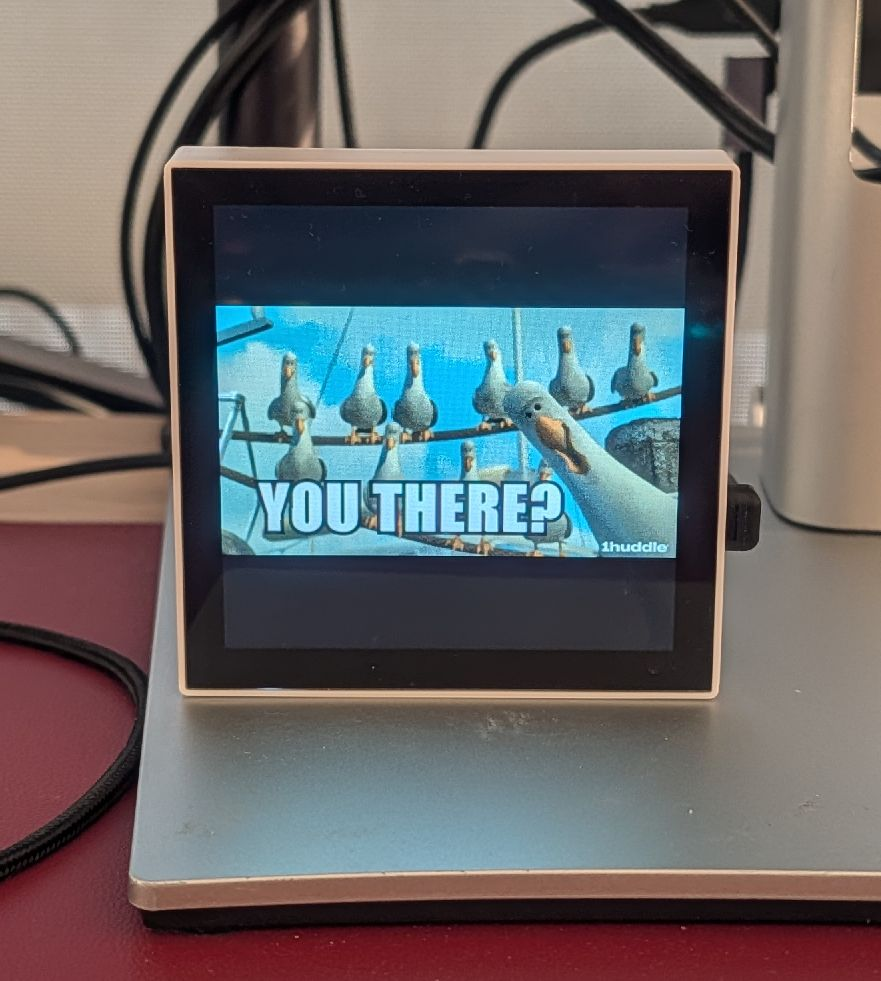
  &nbsp;
  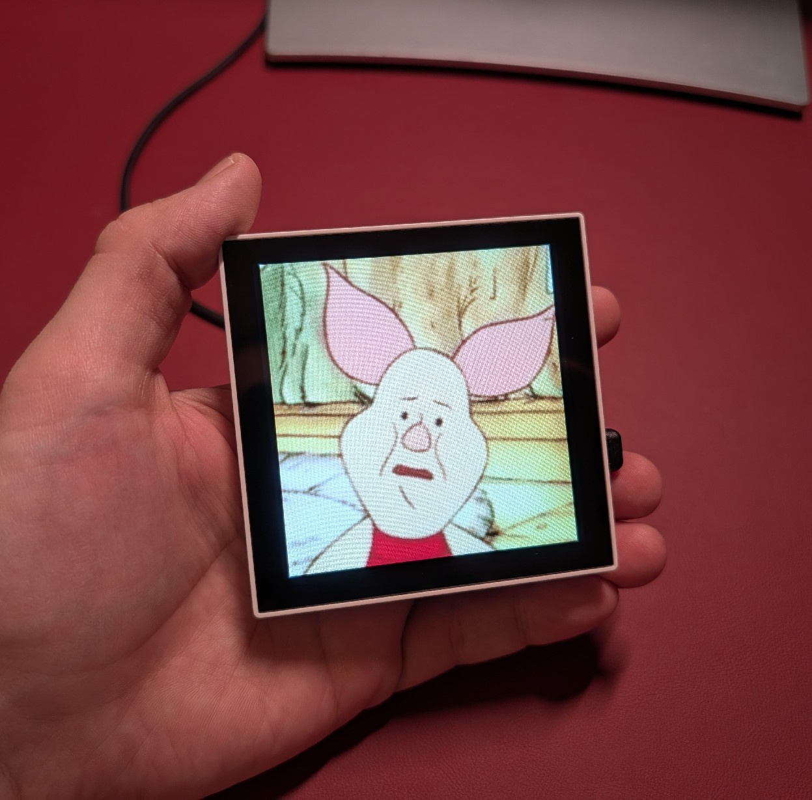
</p>

### Smooth, Gapless Playback

- **Animated WebP, GIF, and APNG; static PNG, JPEG, and BMP**: with alpha/transparency where the format supports it
- **Smart upscaling**: pixel art and local files use nearest-neighbor scaling to keep edges crisp; Giphy, Klipy, and museum content use hardware-accelerated bilinear interpolation for smooth results
- **Triple-buffered rendering** with VSYNC: no tearing, no freezing
- **Aspect ratio preservation**: non-square art is centered on the display with a configurable background color
- **Auto-advance**: cycles to a new artwork every 30 seconds (configurable)

### Touch Controls

| Gesture | Action |
|---------|--------|
| Tap right half | Next artwork |
| Tap left half | Previous artwork |
| Swipe up / down | Pin / unpin the current artwork (swipe up also Likes Makapix artwork; swipe down revokes the Like) |
| Two-finger rotate | Rotate screen (0° / 90° / 180° / 270°) |
| Long press | Show device info / dismiss overlay |

All controls are also available via the web UI and REST API.

### Physical Buttons

<p align="center">
  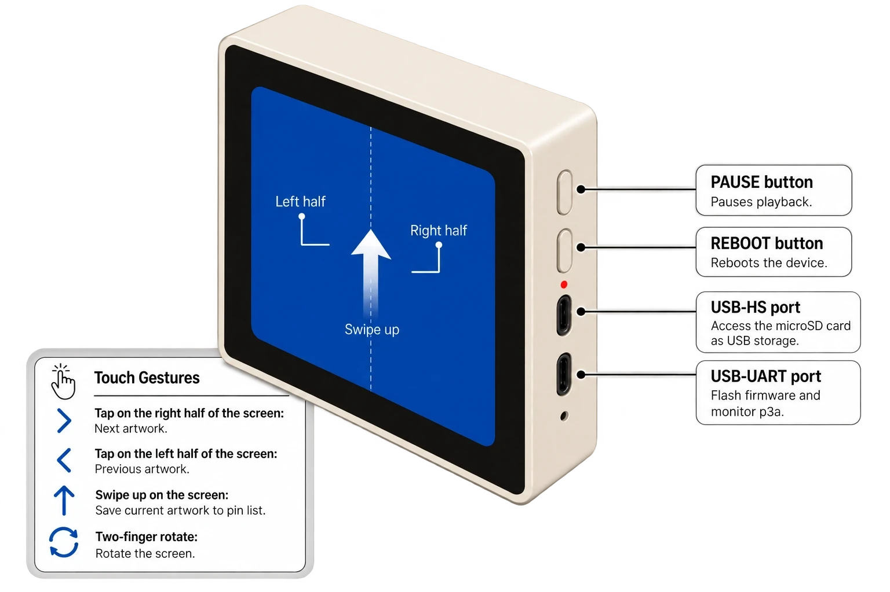
</p>

- **BOOT** (top button, farther from the USB-C ports): pause/unpause: the screen goes black, then resumes on the same artwork
- **RESET** (bottom button): hardware reset: reboots the device immediately

### Web Interface & REST API

Open `http://p3a.local/` from any browser on the same Wi-Fi network for the full dashboard: playback controls, playsets, pin lists, every setting, and firmware updates. It is part of the firmware, so it is always the version that matches the device.

<p align="center">
  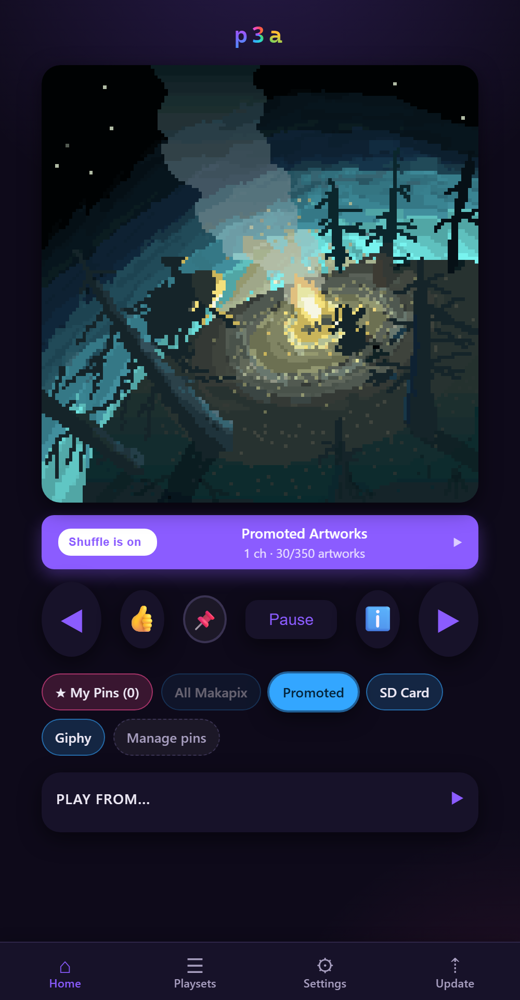
  <br>
  <em>p3a web UI: control everything from the browser</em>
</p>

Everything the pages do goes through a JSON API under `/api/v2/`, open to scripts on your network.

```bash
curl http://p3a.local/api/v2/status                    # Device status
curl -X POST http://p3a.local/api/v2/player/next       # Next artwork
curl -X PATCH http://p3a.local/api/v2/settings \
  -H "Content-Type: application/json" \
  -d '{"rotation": 90}'                                # Rotate screen
```

> The web interface is LAN-only. For remote control, use Makapix Club.

### Wireless Updates

After the first USB flash, updates arrive over Wi-Fi:
- **One file**: the firmware carries the web interface, so there is one update, not two
- **You decide**: the device looks for new releases by itself and never installs one without you
- **One-click install** from the Update page, with progress on the screen and in the browser
- **A way back**: the previous firmware stays on the device, and one click returns to it
- **Self-recovery**: a new firmware that cannot rejoin your network is undone automatically
- **SHA-256 verification** of every download
- **ESP32-C6 co-processor** firmware updates automatically when needed

### USB Storage

Connect via USB-C to mount the microSD card as a removable drive, then drag and drop your own artwork files onto it.

---

## Hardware

p3a runs on the **[Waveshare ESP32-P4-WIFI6-Touch-LCD-4B](https://www.waveshare.com/esp32-p4-wifi6-touch-lcd-4b.htm?sku=31416)** (also on [Amazon](https://www.amazon.com/dp/B0FF3Z1NNL/)), an off-the-shelf development board:

| Component | Details |
|-----------|---------|
| **MCU** | Dual-core ESP32-P4 (RISC-V) + ESP32-C6 co-processor (Wi-Fi 6 / BLE) |
| **Display** | 4" 720x720 IPS, 24-bit color, dimmable backlight |
| **Touch** | 5-point capacitive (GT911) |
| **Memory** | 32 MB PSRAM, 32 MB flash |
| **Storage** | microSD card slot (4-bit SDMMC) |
| **Connectivity** | Wi-Fi 6, Bluetooth LE |
| **Power** | USB-C, any 5V 1A (or more) source (no battery) |
| **Framework** | ESP-IDF v5.5.4 |

<p align="center">
  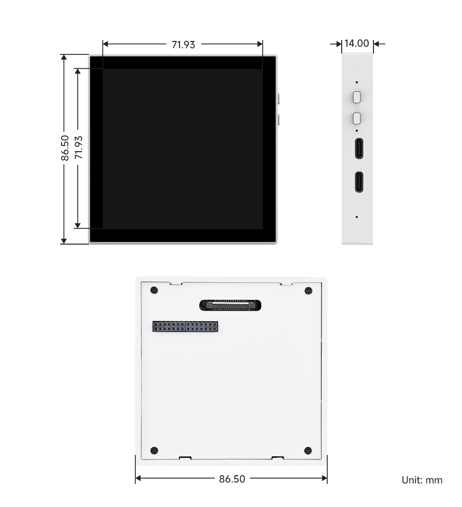
</p>

---

## Makapix Club

<p align="center">
  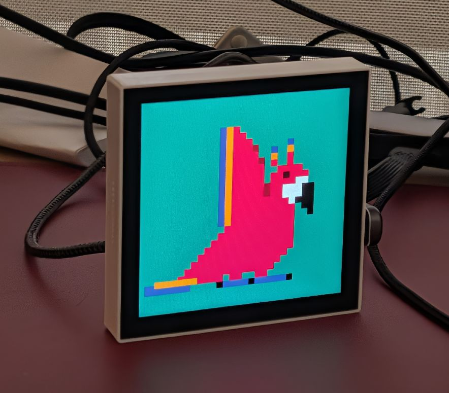
</p>

[Makapix Club](https://makapix.club/) is a pixel art social network where artists share animated creations. Register your p3a to unlock:

- **Browse and send** artworks or entire channels (e.g. "Promoted Artworks", "All Artworks") directly to your device
- **Remote control** from any browser: change artwork and switch channels from anywhere
- **Secure connection** via mutual TLS (mTLS) with per-device certificates
- **Real-time updates**: your device receives artworks and commands instantly over encrypted MQTT

**To register:** open Settings in the web UI (`http://p3a.local/settings`), go to the Makapix tab, and click "Register this device". The device and the page both show a 6-character code. Enter it at [makapix.club](https://makapix.club/). From then on the device connects automatically.

> [Join the Makapix Club Discord](https://discord.gg/xk9umcujXV) to connect with other p3a users and the pixel art community.

---

## For Developers

### How the Firmware Is Built

The firmware is layered, and a component may depend only on layers below its own:

| Layer | Components |
|-------|------------|
| **util** | `p3a_util` (tasks, jobs, events, memory pressure, errors) |
| **board** | `p3a_board` (display, touch, buttons), `sdio_bus`, `slave_ota` (ESP32-C6 firmware) |
| **storage** | `p3a_storage` (SD card, atomic writes, repair), `p3a_settings` (one schema, one store) |
| **library** | `p3a_library` (artwork records, the blob store, pin lists), `p3a_fetch` (every HTTP request) |
| **sources** | `source_local`, `source_makapix`, `source_giphy`, `source_klipy`, `source_museum`, `source_pinned` |
| **player** | `animation_decoder`, `display_renderer`, `animation_player`, `play_scheduler` |
| **ui** | `p3a_ui` (screens, overlays, touch), `p3a_usb` |
| **net** | `p3a_net` (Wi-Fi, setup, the HTTP server and the web pages), `p3a_update` (firmware updates) |

What decides behaviour (which artwork plays next, when a channel refreshes, what a screen shows, which release to install) is plain C without hardware, tested on a workstation. The device adds the hardware around it.

### Storage Layout

| Partition | Size | Purpose |
|-----------|------|---------|
| NVS | 64 KB | Settings, Wi-Fi credentials, registrations |
| Co-processor firmware | 2 MB | The ESP32-C6 image |
| Crash record | 256 KB | The last crash, if any, for diagnosis |
| App slot A / B | 10 MB each | The running firmware and the one before |
| Spare | 9.6 MB | Reserved |
| **SD card** | | All artwork |

SD card layout, under the root folder you choose (default `/p3a`): `animations/` (your own files), `blobs/` (everything downloaded, stored once whatever plays it), `channels/` (each channel's listing), `playsets/`, `pins/`.

---

## Documentation

| Document | Description |
|----------|-------------|
| [QUICK-START.md](docs/QUICK-START.md) | Quick Start Guide: the fastest path from box to art on the screen |
| [HOW-TO-USE.md](docs/HOW-TO-USE.md) | Full user guide: setup, touch controls, Wi-Fi, web UI, REST API, Giphy, Klipy, museums |
| [migrating-to-2.0.md](docs/migrating-to-2.0.md) | Moving a device from p3a 1.x to 2.0 |
| [flash-p3a.md](docs/flash-p3a.md) | Flashing instructions (web flasher and alternatives) |
| [Infrastructure docs](docs/infrastructure/README.md) | Technical architecture for developers and contributors |

## Community

- **Discord**: [Makapix Club Discord](https://discord.gg/xk9umcujXV) for discussion, tips, and pixel art
- **Makapix Club**: [makapix.club](https://makapix.club/) to browse and share pixel art
- **Issues**: [GitHub Issues](../../issues) for bug reports and feature requests

## Contributing

Contributions are welcome. By contributing, you agree that your work will be licensed under the Apache License 2.0.

Start with the [infrastructure docs](docs/infrastructure/README.md) for technical details about the codebase.

## License

Apache License 2.0. See [LICENSE](LICENSE). For dependency licenses, see [LICENSING.md](LICENSING.md).

## Acknowledgements

Thanks to ByteWelder from the *Espressif MCUs* Discord server for advice in the early days of p3a.
