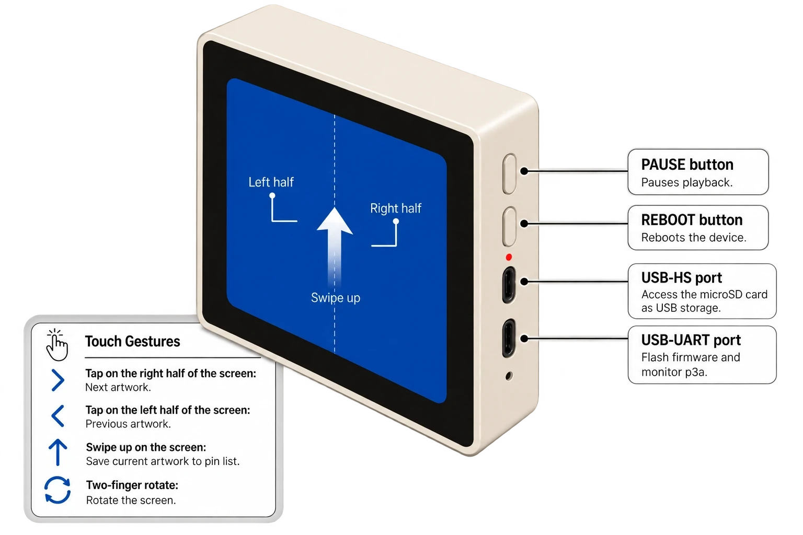

# How to Use p3a

This guide covers everything you need to know to use your p3a pixel art player, from initial setup to advanced features.

> **First time setting up?** Start with the [Quick Start Guide](QUICK-START.md), it walks through the bare minimum to see art on the screen in about 15 minutes. Come back here for the deeper details.

p3a is built for continuous 24/7 operation. Once it's set up, you can leave it running on a shelf or wall indefinitely, no scheduled reboots, no babysitting required.

## Table of Contents

1. [Initial Setup](#initial-setup)
2. [Wi-Fi Setup](#wi-fi-setup)
3. [Touch Controls](#touch-controls)
4. [Physical Buttons](#physical-buttons)
5. [Web Interface](#web-interface)
6. [Preparing Artwork](#preparing-artwork)
7. [USB SD Card Access](#usb-sd-card-access)
8. [Giphy Integration](#giphy-integration)
9. [Klipy Integration](#klipy-integration)
10. [Museum Channels](#museum-channels)
11. [Device Registration](#device-registration)
12. [Makapix Club Features](#makapix-club-features)
13. [Firmware Updates](#firmware-updates)
14. [SD Card Sizing and Automatic Cleanup](#sd-card-sizing-and-automatic-cleanup)
15. [REST API](#rest-api)
16. [Troubleshooting](#troubleshooting)

---

## Initial Setup

### What you need

- Waveshare ESP32-P4-WIFI6-Touch-LCD-4B board
- USB-C data cable (not a charging-only cable)
- microSD card (4 GB minimum, **FAT32**: p3a can format it for you on-device)
- any USB power source
  - p3a draws very little power, so any 5V 1A (or more) phone charger or a computer USB port is plenty
- a small screwdriver
- a computer (Windows, Mac, or Linux), needed once, for the initial firmware install. Everything after that is wireless.

### First-time setup

1. **Insert the microSD card** into the slot on the board. This requires unscrewing the back plate.
2. **Flash the firmware**. See [flash-p3a.md](flash-p3a.md) for instructions.
3. **Configure Wi-Fi** by following the [Wi-Fi Setup](#wi-fi-setup) instructions below.

> **SD card format:** the card must be FAT32 (or FAT16), p3a does not read exFAT or NTFS, and cards larger than 32 GB usually ship formatted as exFAT. p3a **never erases or reformats a card unasked**: a card it can't read shows a **"No Usable SD Card"** screen with a **"Format card for p3a"** button, tap it, read the erase warning, and confirm to have p3a format the card as FAT32 and restart. (If a card starts failing later during operation, the same option appears as **"Format SD card"** on the long-press info screen; you can rescue files first over USB, see [USB SD Card Access](#usb-sd-card-access).) To format the card on a computer instead, note that Windows' built-in Format dialog caps FAT32 at 32 GB, use a tool such as [guiformat](http://ridgecrop.co.uk/guiformat.htm) or [Rufus](https://rufus.ie) for larger cards.

Any card from 4 GB up works. Bigger cards hold a bigger artwork cache (fewer re-downloads), details in [SD Card Sizing and Automatic Cleanup](#sd-card-sizing-and-automatic-cleanup).

> **Card corruption and self-repair:** some microSD cards, usually no-name ones and usually after a power cut, quietly write blocks of data to the wrong place. When that lands on one of p3a's folders or on the card's file allocation table, files in that folder become unreachable and saving there fails. p3a detects both cases and repairs them on its own: a damaged folder is moved to `lost/` in the SD card root and recreated empty (caches simply download again), and a damaged allocation table is restored from the card's mirror copy at boot. The device shows a short **"SD card repaired"** notice on screen once per boot after the first repair, the web UI shows an **"SD Card Corruption Repaired"** banner with the repair count, and `GET /api/v2/status` reports the count under `storage.repairs`. Treat any repair as a warning: a card that needs repairing is losing data, so copy anything you care about off it and replace it. You can delete `lost/` over USB (or format the card) once you have looked at it.

---

## Wi-Fi Setup

### First boot / new network

If the device can't connect to a saved network, it starts a captive portal:

1. **Connect to the Wi-Fi network** `p3a-setup` from your phone or computer
2. **A setup page should open automatically.** If not, open `http://p3a.local/` or `http://192.168.4.1` in your browser
3. **Enter your Wi-Fi credentials** (SSID and password)
4. **Click "Save & connect"**
5. The device reboots and connects to your network

### After connection

Once connected, you can access the device at:
- **mDNS**: `http://p3a.local/` (works on most networks)
- **IP address**: Long-press on the screen to show the info screen with the device's IP address

---

## Touch Controls

The 720×720 touchscreen recognizes these gestures:

| Gesture | Action |
|---------|--------|
| **Tap right half** | Advance to next artwork |
| **Tap left half** | Go back to previous artwork |
| **Swipe up** | Pin the current artwork to the active pin list; on Makapix artwork this also sends a Like, on Giphy artwork it registers a click |
| **Swipe down** | Undo the swipe up: unpin the artwork, and revoke the Like if it's a Makapix artwork |
| **Two-finger rotate** | Rotate screen (clockwise or counter-clockwise) |
| **Long press** | Show device info / dismiss overlay |

Pin lists are managed from the home page (`http://p3a.local/`, **Manage pins**), and a playset can play a pin list as one of its channels. Swiping on a local SD-card file shows an error indicator, local files can't be pinned or reacted to.

### Screen Rotation

Place two fingers on the screen and rotate them like turning a dial, at roughly 45° of finger rotation, the screen rotates 90° in the same direction. All four orientations (0°, 90°, 180°, 270°) are supported. The rotation applies to both artwork playback and the UI, is saved automatically, and persists across reboots. You can also set rotation via the web interface or [REST API](#rest-api).

### Auto-advance

When idle (no touch or API interaction), the device automatically advances to the next artwork roughly every 30 seconds. The next artwork is chosen by the device's pick-mode setting (recency or random). The interval is configurable via the web interface or REST API.

---

## Physical Buttons

Besides the touchscreen, the board has two small push-buttons next to the USB-C ports:

<p align="center">
  
</p>

| Button | Position | Action |
|--------|----------|--------|
| **BOOT** | Top, farther from the USB-C ports | Pause / unpause playback |
| **RESET** (RST) | Bottom, closer to the USB-C ports | Hardware reset: reboots the device immediately |

**BOOT** toggles pause: press it and the screen goes black; press it again and the same animation that was playing resumes. It controls the same pause state as the web dashboard's Pause/Resume controls and the `POST /api/v2/player/pause` / `POST /api/v2/player/resume` [REST API](#rest-api) endpoints, so you can freely pause with one and resume with another.

**RESET** is wired straight to the chip's reset line, the firmware can't see it or change what it does. Pressing it is equivalent to unplugging and replugging power: safe at any time, and the device boots right back into playback.

> **Tip:** Holding BOOT while pressing RESET puts the board into serial download mode (used for USB flashing). If you ever land there by accident, screen stays dark, just press RESET alone to boot normally.

---

## Web Interface

Open `http://p3a.local/` in any browser on the same Wi-Fi network to access the web dashboard.

The web interface provides:
- **Device status**: current artwork (Wi-Fi info is on the Settings > Network tab; uptime on Settings > System)
- **Playback controls**: next, previous, pause, resume
- **Configuration**: brightness, screen rotation, settings
- **Boot animation**: the device plays one of 22 intro animations, picked at random on each boot; under Settings > Display > "Boot Logo Animation" you can pick a specific one instead and set how long it plays (1–7.5 s, default 3 s)
- **Playsets**: build mixes of channels from every source at `http://p3a.local/playsets`
- **Updates**: see what is installed, what is available, and go back to the previous firmware at `http://p3a.local/update`

> **Note:** The web interface is only accessible on your local network, not over the internet. For remote control, register your device at [makapix.club](https://makapix.club/).

### Playsets

A playset is a named mix of channels. At `http://p3a.local/playsets`, click **Create New**, give it a name, and click **Add channel** for each channel you want. Each channel is one line in the list, with its share of the turns on the right and the same colors in the bar above the list. Click a line to open it:

- **Name**: what the channel is called on the home page. Leave it empty to keep the name it came with.
- **Weight**: how often this channel plays against the others. A channel with twice the weight plays twice as often. A weight of 0 mutes the channel without removing it.
- **Offset** (Giphy, Klipy, museums and pin lists): skips that many artworks from the start of the channel.
- **Keep** (Makapix, Giphy, Klipy and museums): how many artworks this channel holds in this playset. Leave it empty to use the number from Settings.
- **Refresh** (the same four): how often this channel looks for new artworks in this playset. **Default** uses the interval from Settings.
- **Up** and **Down** move the channel in the list; on a computer you can also drag a line by its handle. **Remove** takes it out of the playset.

**Keep** and **Refresh** belong to the channel in that one playset, so the same channel can be small and fresh in one playset and large in another. The limits are those of the same settings in Settings, and they differ by source: a museum channel can wait up to 8 days between refreshes, a Giphy channel up to 8 hours. Making a channel smaller does not delete anything from the SD card; artworks already downloaded stay until the card needs the room.

**Save** stores the playset; **Save & Play** also switches the device to it.

---

## Preparing Artwork

### Supported formats

- **WebP** (animated and static), recommended for best quality and compression; supports transparency
- **GIF** (animated and static), supports transparency
- **PNG / APNG** (animated and static), supports transparency with full alpha channel; `.apng` files are accepted too
- **JPEG** (static)
- **BMP** (static), all common variants (1/4/8/16/24/32-bit, RLE compression); transparency supported for files with an explicit alpha mask

Images with transparency are composited over a background color configurable via the web interface or REST API.

### File organization

Your own files live inside a single folder on the microSD card. By default:

```
/p3a/animations/
```

The firmware looks **only** in this folder for local artwork, it does not scan the rest of the card. If the folder is missing or empty, the local channel simply shows zero artworks.

The `p3a` root folder is configurable at `http://p3a.local/settings` > **Storage** tab > *SD Card Storage*. Whatever you set there (e.g. `/myart`) becomes the folder p3a uses for **all** of its data, your own files, downloaded artwork, channel listings, playsets and pin lists, and your artwork then belongs in `<your-root>/animations/` instead. Changes require a reboot. Before manually placing files on the card, check that tab to confirm the current root.

Two ways to copy files onto the card:
- **USB**: connect a USB-C cable from the **HS port** to your computer and the SD card appears as a removable drive (see [USB SD Card Access](#usb-sd-card-access))
- **Web upload**: drag and drop files onto the dashboard at `http://p3a.local/`; uploads are saved into `<root>/animations/` automatically

### Image guidelines

- **Any aspect ratio works**: non-square images are scaled to fit while preserving the original aspect ratio
- **Small pixel art is upscaled**: a 128×128 image will be scaled up to fill the display
- **Smart upscaling**: Giphy, Klipy, and museum content uses hardware-accelerated bilinear interpolation for smooth results; everything else (Makapix, local files, pinned artwork) uses nearest-neighbor scaling to preserve crisp pixel edges
- **Centered display**: artwork is centered on the 720×720 display over the configurable background color

---

## USB SD Card Access

p3a has two USB-C ports, but only one (the High-Speed port) works as a USB storage device (see the [Physical Buttons](#physical-buttons) diagram).

1. **Connect a USB-C cable** from the HS port to your computer
2. **The microSD card appears as a removable drive**: copy, delete, or organize files as needed
3. **Eject the drive** before disconnecting

While connected, the SD card is locked for the device: the screen shows a USB-mode indicator and you can't change artwork until you disconnect. Normal operation resumes automatically after disconnecting. Works with computers, smartphones (with USB OTG), and tablets.

---

## Giphy Integration

p3a can play trending animated GIFs directly from [Giphy](https://giphy.com/). Once configured, Giphy channels appear alongside your Makapix and local artwork channels, and you can mix them in the same playset.

### Getting a Giphy API key

To use Giphy, you need a free API key:

1. Go to [developers.giphy.com](https://developers.giphy.com/) and sign up
2. Create an app and copy the API key
3. Open the p3a settings page at `http://p3a.local/settings#giphy`
4. Paste your API key and click **Save** next to it. The page then shows "Key set"; the key itself is never shown again

### Configuring Giphy

The Giphy tab at `http://p3a.local/settings#giphy` lets you customize:

| Setting | Options | Description |
|---------|---------|-------------|
| **Content Rating** | G, PG, PG-13, R | Filters content by age-appropriateness |
| **Refresh Interval** | 1, 2, 4, or 8 hours | How often p3a fetches fresh trending content from Giphy |
| **Cache Size** | 32–500 items | Maximum number of GIFs kept per Giphy channel |

> Rendition (resolution) and format (WebP/GIF) are settings too (`giphy_rendition`, `giphy_format`, `giphy_prefer_downsized`), changed through the [REST API](#rest-api) rather than the page.

### How it works

- p3a periodically fetches each Giphy channel's listing and keeps the GIFs it downloads in `blobs/` under your SD card root, with everything else it downloads
- GIFs are downloaded on demand as they come up in the rotation, so the first few plays may take a moment, once cached, playback is instant

---

## Klipy Integration

p3a can play GIFs and stickers from [Klipy](https://klipy.com/). Klipy offers three channel kinds, trending, search, and category, each available for both GIFs and stickers, and Klipy channels mix into playsets like any other source.

### Getting a Klipy API key

To use Klipy, you need a free API key:

1. Go to [partner.klipy.com](https://partner.klipy.com/) and sign up
2. Copy your app's API key
3. Open the p3a settings page at `http://p3a.local/settings#klipy`
4. Paste your API key and click **Save** next to it

> Test keys are limited to 100 requests per hour. Each request returns up to 50 items, so a 500-item channel takes 10 requests to refresh. Production keys are unlimited.

### Configuring Klipy

The Klipy tab at `http://p3a.local/settings#klipy` lets you customize:

| Setting | Options | Description |
|---------|---------|-------------|
| **Content Rating** | G, PG, PG-13, R | Filters content by age-appropriateness |
| **Format** | GIF or WebP | Downloaded file format. GIF by default; WebP has a smaller download footprint |
| **Refresh Interval** | 1, 2, 4, or 8 hours | How often p3a fetches fresh content from Klipy |
| **Cache Size** | 32–2500 items | Maximum number of artworks kept per Klipy channel |

### How it works

- p3a periodically fetches each channel's listing from the Klipy API and keeps what it downloads in `blobs/` under your SD card root
- Artworks are downloaded on demand as they come up in the rotation, once cached, playback is instant

---

## Museum Channels

p3a can play artwork from major museums that publish their collections online, most through the [IIIF Image API](https://iiif.io/api/image/3.0/), the Cleveland Museum of Art and the Minneapolis Institute of Art through their own open-access image CDNs. Channels are organized by the museum's own facets (collections, departments, sets, ...) and refreshed on a schedule. Eight museums are available today:

| Museum | Facets you can pick |
|---|---|
| **Rijksmuseum** | Curated Sets (Rijks's own collection groupings) |
| **Victoria and Albert Museum** | Collections, Categories, Venues |
| **Wellcome Collection** | Work types, Genres, Subjects, Contributors |
| **Statens Museum for Kunst (SMK)** | Collections |
| **Harvard Art Museums** | Classifications, Centuries, Cultures, Periods, Places, Media, Techniques, Work types, Groups, Galleries |
| **Smithsonian** | Museums (Cooper Hewitt, SAAM, NPG, NMAAHC, Hirshhorn, African Art) |
| **Cleveland Museum of Art** | Departments, Types. CC0 works only |
| **Minneapolis Institute of Art** | Classifications, Departments, Countries, Styles, public-domain works only |

The Art Institute of Chicago is temporarily unavailable: since 2026-08 its image server blocks direct access from devices, so AIC channels can't fetch new artwork. AIC art already on the card keeps playing.

Six of the eight museums need no account or API key. Two do:

- **Harvard Art Museums**: request a free key at [harvardartmuseums.org/collections/api](https://harvardartmuseums.org/collections/api) (delivered by email within a day) and paste it into **Settings > Museum > Harvard Art Museums API key**.
- **Smithsonian**: register at [api.data.gov/signup/](https://api.data.gov/signup/) (instant, email-based) and paste the key into **Settings > Museum > Smithsonian API key**. One api.data.gov key covers Smithsonian and every other api.data.gov service (NASA, NOAA, etc.). Don't use `DEMO_KEY`, its ~30 req/hour-per-IP cap will throttle the first refresh mid-flight.

Until a key is saved, the corresponding museum entry in the browse modal will prompt you to add one, and any channel you've already created sits dormant, it reactivates the moment a valid key is saved, no need to re-create it.

### Adding a museum channel

1. **Open Playsets** at `http://p3a.local/playsets`
2. Open or create a playset and click **Add channel**
3. Set **From** to **Museum** and click **Browse museums**
4. A browse modal opens. Pick the museum, then the facet/axis (skipped for Rijks, which is axis-less), then the term you want
5. The modal previews one artwork at a time at 400 px, with **Previous** / **Next** navigation and a title/artist/date caption. The **Add channel** button commits the channel, not the visible artwork. (Rijks previews resolve lazily, so the first thumbnail takes a moment)
6. Save the playset (**Save**, or **Save & Play** to switch to it at once)

The channel saves under a name like `V&A · Photographs` or `CMA · Japanese Art`, shortened with an ellipsis past 63 characters; you can rename it in the editor. In the API such a channel has the kind `{museum_id}:{axis}` and the facet's term as its identifier.

### Refresh and download behavior

- **Refresh interval and cache size** are configured in **Settings > Museum** (`http://p3a.local/settings#museum`). Defaults: refresh every 4 days, keep up to 1024 artworks per channel. A channel can have its own in a playset, see [Playsets](#playsets).
- **First refresh** fetches the listing from the museum's API. Image downloads happen lazily as the device rotates through the playset, the first artworks appear within seconds, the rest fill in over the next minutes.
- **Downloaded artworks** are stored once in `blobs/` under your SD card root, whatever plays them: two channels with the same artwork, or a channel and a pin list, only pay for it once. Cleanup is automatic (see [SD Card Sizing and Automatic Cleanup](#sd-card-sizing-and-automatic-cleanup)).
- **Rijks artworks** require a "Linked Art walk" (three follow-up HTTP requests per artwork) to discover the actual IIIF identifier. The device does this lazily in the background, so a fresh Rijks channel takes ~50 minutes to fully populate, but the first few artworks appear within seconds.
- **Rate limits** are honored per-museum. Harvard and the Smithsonian cap requests per API key (see **Settings > Museum**); the others don't publish a limit, but when a museum answers "too many requests" p3a waits before asking again. The device and the browse modal in your browser each keep their own wait.

---

## Device Registration

Register your p3a at [makapix.club](https://makapix.club/) to enable cloud features:

- **Send artworks directly**: browse artworks on the website and send them straight to your p3a
- **Remote control**: change artwork, adjust brightness from anywhere
- **Status monitoring**: see your device's online status
- **Send reactions**: swipe up on a Makapix artwork to give it a thumbs-up; swipe down to revoke

### How to register

1. **Open the settings page** at `http://p3a.local/settings`, go to the Makapix tab, and click **Register this device**
2. **A registration code appears** on the display and on the page (6 characters)
3. **Go to [makapix.club](https://makapix.club/)** on your phone or computer
4. **Enter the registration code** and link it to your account
5. **The device connects automatically** over a secure connection

The registration code expires after 15 minutes. If it expires, click **Register this device** again to get a new code.

### Security

- Communication uses TLS 1.2 with mutual certificate authentication (mTLS)
- Each device gets unique client certificates during registration
- Commands are authenticated and encrypted end-to-end

---

## Makapix Club Features

Once your device is registered at [makapix.club](https://makapix.club/), you can use these cloud features:

### Sending artworks to your p3a

1. Browse artworks on [makapix.club](https://makapix.club/)
2. Click on any artwork to view it
3. Click the **"Send to p3a"** button
4. The artwork is sent directly to your device and displayed immediately

Supported formats: WebP, GIF, and APNG (animated, with transparency), PNG (still images, with transparency), and JPEG (still images).

### Remote control

From the Makapix Club website, you can:
- View your device's current status and artwork
- Navigate between artworks (next/previous)
- Adjust brightness
- Control playback (pause/resume)

---

## Firmware Updates

After the first flash over USB (see [flash-p3a.md](flash-p3a.md)), p3a updates over Wi-Fi. The web interface is part of the firmware, so there is one update, not two.

- The device looks for a new release two minutes after it joins your network and every 12 hours after that. You can turn this off under **Settings > System**
- Updates are **never installed automatically**: you always approve them
- When one is available, a dot appears on the **Update** tab and a banner on the home page. Open `http://p3a.local/update`, read the release notes, click **Install**, and confirm
- Progress is shown on the device's screen and on the page. The device restarts when it is done, and the page follows it across the restart

> The update takes 1-2 minutes. Losing power midway is harmless: the new firmware is written to the second of two slots and only chosen at the very end, so the device boots the firmware it had and you can start again.

### A new firmware is on trial

For the first minutes after an update, the new firmware is on trial. It is kept as soon as the device is back on your network with its web page up. If it cannot get there within ten minutes, the device restarts into the firmware it ran before, by itself, and the Update page says that the version was undone. An update cannot leave you with a device you can no longer reach.

### Going back

The device keeps the firmware it ran before the last update. `http://p3a.local/update` shows it as "Also on this device" with a **Go back** button. Click it and confirm; the device restarts into that firmware. You can switch forward again the same way.

### Pre-releases

**Settings > System > Offer pre-release firmware** also offers versions that are still being tested. They may have faults, and you can go back from them like from any other.

### REST API

Everything the web interface does goes through a JSON API under `/api/v2/`, and the same API is open to scripts on your network. Every answer has the same shape: `{"ok": true, "data": {...}}`, or `{"ok": false, "code": "...", "error": "..."}` with a code for programs and a sentence for people.

### Device status

```bash
curl http://p3a.local/api/v2/status
```

Returns the firmware version, network, time, storage, memory, and uptime. What is playing is under `GET /api/v2/player`: the current artwork, the active playset's channels and their state.

### Control playback

```bash
# Next and previous artwork
curl -X POST http://p3a.local/api/v2/player/next
curl -X POST http://p3a.local/api/v2/player/back

# Pause and resume
curl -X POST http://p3a.local/api/v2/player/pause
curl -X POST http://p3a.local/api/v2/player/resume

# Show a picture from an address
curl -X POST http://p3a.local/api/v2/player/show \
  -H "Content-Type: application/json" -d '{"url": "https://example.com/art.gif"}'

# Restart the device
curl -X POST http://p3a.local/api/v2/system/reboot
```

### Settings

Every setting is read and changed the same way. `GET /api/v2/settings/schema` lists them all with their types and limits.

```bash
# Read every setting (API keys are shown masked)
curl http://p3a.local/api/v2/settings

# Change one or several: here, rotate the screen (0, 90, 180, or 270 degrees)
curl -X PATCH http://p3a.local/api/v2/settings \
  -H "Content-Type: application/json" -d '{"rotation": 90}'
```

A value outside its limits is refused with a message that says why, and nothing is changed.

### Playsets and pin lists

```bash
# The saved playsets, and one of them
curl http://p3a.local/api/v2/playsets
curl http://p3a.local/api/v2/playsets/Evening%20mix

# Play a saved playset
curl -X PUT http://p3a.local/api/v2/player/playset \
  -H "Content-Type: application/json" -d '{"saved": "Evening mix"}'

# The pin lists
curl http://p3a.local/api/v2/pins
```

### File management

Upload a file into your own folder with `POST /api/v2/files?name=<file name>`, the file as the request body; it plays at once. There are no endpoints for browsing, renaming, or deleting files: use [USB SD Card Access](#usb-sd-card-access) for that.

---

## Troubleshooting

### Device doesn't appear as `p3a.local`

- mDNS doesn't work on all networks (especially corporate/guest networks)
- Find the device's IP address from your router's DHCP client list, or by long-pressing on the screen to show the info screen
- Access the device at `http://<IP-ADDRESS>/` instead

### Touch not responding

- Clean the screen, the capacitive touch can be affected by moisture or debris
- Restart the device by unplugging and reconnecting power

### Can't connect to Wi-Fi

- Ensure you're entering the correct password
- The device supports WPA2 and WPA3 networks
- If the captive portal doesn't appear, manually browse to `http://p3a.local/` or `http://192.168.4.1`

### Need more help?

Check the [infrastructure docs](infrastructure/README.md) for technical details, or open an issue on the GitHub repository.
