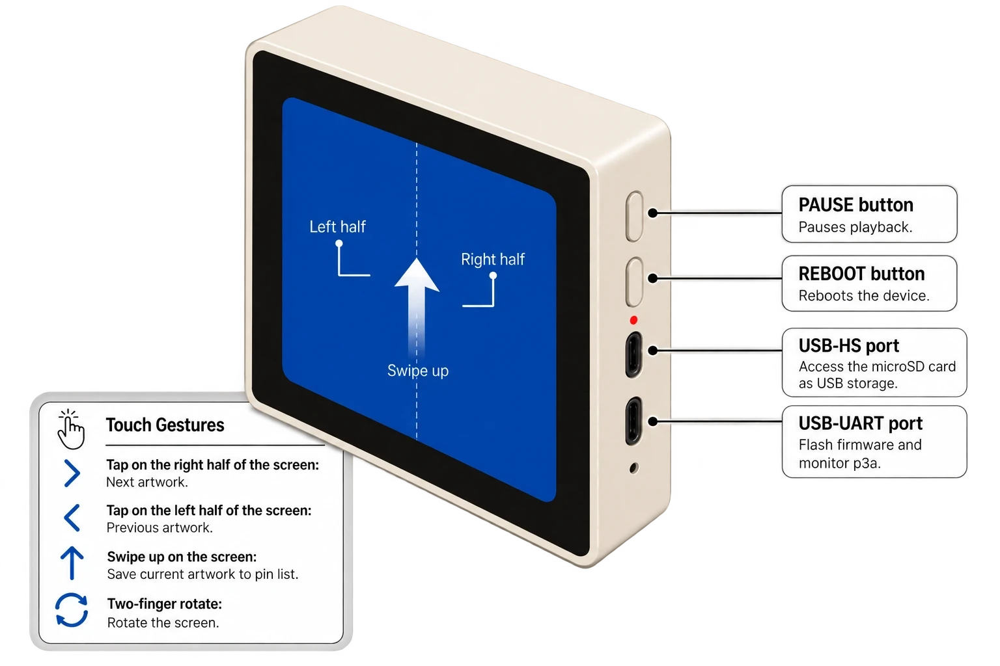

# Flash p3a Firmware

Flash the p3a firmware to your Waveshare ESP32-P4 board. You do this once. After that, the device updates itself over Wi-Fi from its own Update page (`http://p3a.local/update`).

> **Just got your board?** This page goes into each flashing method. For one walkthrough that covers flashing, Wi-Fi setup, and seeing your first artwork, start with the [Quick Start Guide](QUICK-START.md).

> **A USB flash starts the device fresh.** It erases the device's settings, its Wi-Fi network and its Makapix Club registration. Files on the SD card are kept. On a new board there is nothing to lose. If the device runs p3a 1.x, read [Moving a p3a from 1.x to 2.0](migrating-to-2.0.md) first.

Whichever method you pick, plug the cable into the **UART** port: the USB-C port farther from the buttons. The other port (HS) is for USB storage, not flashing.

<p align="center">
  
</p>

---

## Option 1: Web Flasher (recommended)

The easiest way to flash your p3a. Nothing to install: it runs in the browser.

**Requirements:** Chrome 89+ or Edge 89+ (Firefox and Safari don't support WebSerial)

1. Go to the [**p3a Web Flasher**](https://fabkury.github.io/p3a/web-flasher/)
2. Select the firmware version from the dropdown
3. Tick the box under the warning that the flash erases the device
4. Connect your p3a via USB-C (UART port)
5. Click **Connect** and select your device from the browser prompt
6. Click **Flash Device**
7. Wait about 2 minutes. The device reboots into p3a.

The web flasher works on Windows, macOS, and Linux.

---

## Option 2: p3a Flasher (Windows)

A standalone Windows program, useful if you don't have Chrome or Edge, or want to flash without an Internet connection.

1. Download `p3a-flasher.exe` from the [latest GitHub Release](https://github.com/fabkury/p3a/releases/latest)
2. Connect your p3a via USB-C (UART port)
3. Run `p3a-flasher.exe`
4. Click **Flash Device**, and confirm that the device may be erased
5. Wait about 2 minutes. The device reboots into p3a.

The flasher finds your device by itself and carries the firmware inside it: no installation, configuration or Internet connection needed.

---

## Option 3: Command Line (all platforms)

For macOS, Linux, or if you prefer the command line.

### Step 1: Install Python and esptool

**Windows:**
1. Download Python from [python.org](https://www.python.org/downloads/)
2. During installation, check **"Add Python to PATH"**
3. Open PowerShell and run:
   ```powershell
   pip install esptool
   ```

**macOS:**
```bash
brew install python
pip3 install esptool
```

**Linux:**
```bash
sudo apt install python3 python3-pip
pip3 install esptool
```

### Step 2: Download the firmware

1. Go to [github.com/fabkury/p3a/releases](https://github.com/fabkury/p3a/releases)
2. From the latest release, download `p3a-<version>-usb-flash.zip`
3. Extract it to a folder (e.g., `p3a-firmware`)

The folder holds the files to write, a `flash_args` file that says where each one goes, and `flash_command.txt` with the command below.

### Step 3: Connect the board

1. Use a **USB-C data cable** (charging-only cables won't work)
2. Connect to the **UART (flashing/serial) USB-C port** on your board. It is labelled UART/Serial on the silkscreen. The HS port is for USB storage.
3. Find your serial port:
   - **Windows:** Open Device Manager > Ports and note the COM number (e.g., `COM5`)
   - **macOS:** Run `ls /dev/cu.usb*` in Terminal
   - **Linux:** Run `ls /dev/ttyUSB*` or `ls /dev/ttyACM*`

### Step 4: Flash

Open a terminal in the firmware folder and run one command:

**Windows PowerShell:** (replace `COM5` with your port)
```powershell
python -m esptool --chip esp32p4 -p COM5 -b 460800 --before default_reset --after hard_reset write_flash --flash_mode dio --flash_freq 80m --flash_size 32MB --force "@flash_args"
```

**Windows Command Prompt:**
```cmd
python -m esptool --chip esp32p4 -p COM5 -b 460800 --before default_reset --after hard_reset write_flash --flash_mode dio --flash_freq 80m --flash_size 32MB --force @flash_args
```

**macOS/Linux:** (replace `/dev/ttyUSB0` with your port)
```bash
python3 -m esptool --chip esp32p4 -p /dev/ttyUSB0 -b 460800 --before default_reset --after hard_reset write_flash --flash_mode dio --flash_freq 80m --flash_size 32MB --force @flash_args
```

`--force` is needed because one of the files is the firmware of the board's second chip (the ESP32-C6 that does Wi-Fi), which esptool would otherwise refuse to write to an ESP32-P4.

Wait about 2 minutes for flashing to complete.

### Step 5: Done

The device reboots into p3a:
1. The p3a splash screen appears
2. The screen shows how to join the device to Wi-Fi: connect to the `p3a-setup` network and follow the page that opens
3. Open your p3a at `http://p3a.local/`

---

## Troubleshooting

| Problem | Solution |
|---------|----------|
| "No serial port found" | Try a different USB cable: many are charge-only |
| "Failed to connect" | Hold the **BOOT** button (the top one, farther from the USB-C ports) while connecting |
| Permission denied (Linux) | Run: `sudo usermod -a -G dialout $USER` then log out and in |
| Wrong COM port (Windows) | Check Device Manager > Ports |
| Timeout errors | Try `-b 115200` instead of `-b 460800` |

---

## After flashing

### Wireless updates

After the first flash, update over Wi-Fi:
1. Open `http://p3a.local/update` in your browser
2. Click "Check for Updates"
3. Click "Install" if a newer version is offered

The device also looks for updates by itself and shows a dot on the Update tab when one is available. It never installs one without you. After an update, the Update page can take the device back to the firmware it ran before.

### Adding artwork

Copy WebP, GIF, PNG/APNG, JPEG, or BMP files to a `p3a/animations/` folder on a microSD card (create a `p3a` folder at the root of the card, and an `animations` folder inside it), then insert it into your p3a.

See [HOW-TO-USE.md](HOW-TO-USE.md) for detailed instructions.

---

## Advanced: build from source

For developers who want to change the firmware. It needs [ESP-IDF v5.5.4](reference/esp-idf-5.5.4-setup.md).

```bash
git clone https://github.com/fabkury/p3a.git
cd p3a
python host/p3a-lab/lab.py build release     # builds into build/ and runs the build checks
python tools/make_release.py --allow-dev     # makes release/v<version>/, the folder a release is published from
```

`make_release.py` refuses a version that ends in `-dev` unless told `--allow-dev`; set `PROJECT_VER` in the root `CMakeLists.txt` for a real release. On Windows, `python host/p3a-flasher/build_flasher.py release/v<version>` then builds `p3a-flasher.exe` with that firmware inside.

`AGENTS.md` at the root of the repository describes the tree, the build and the tests.
